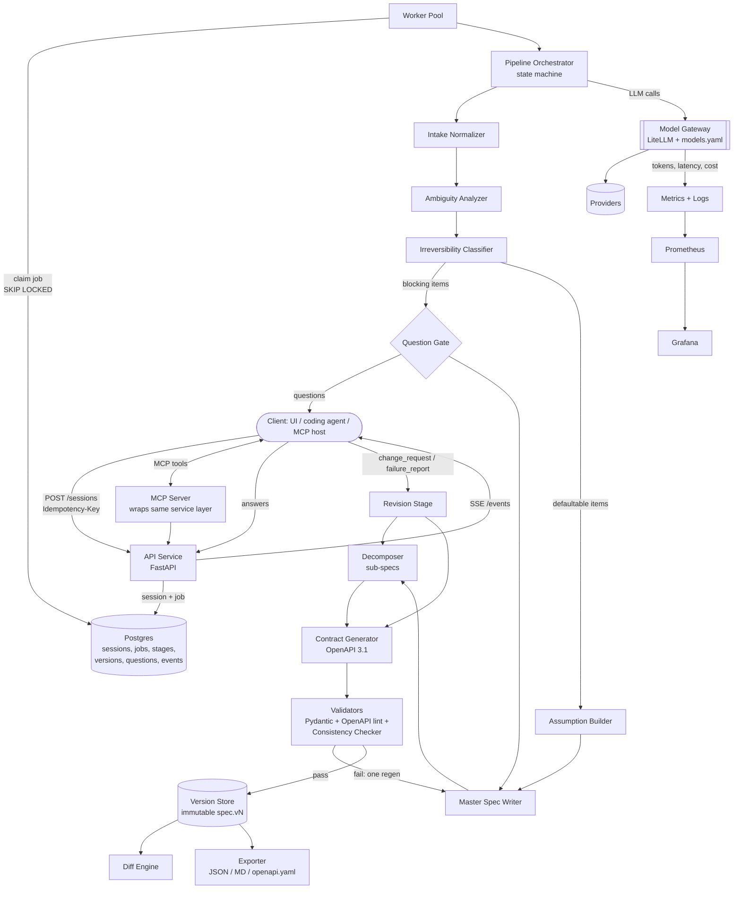
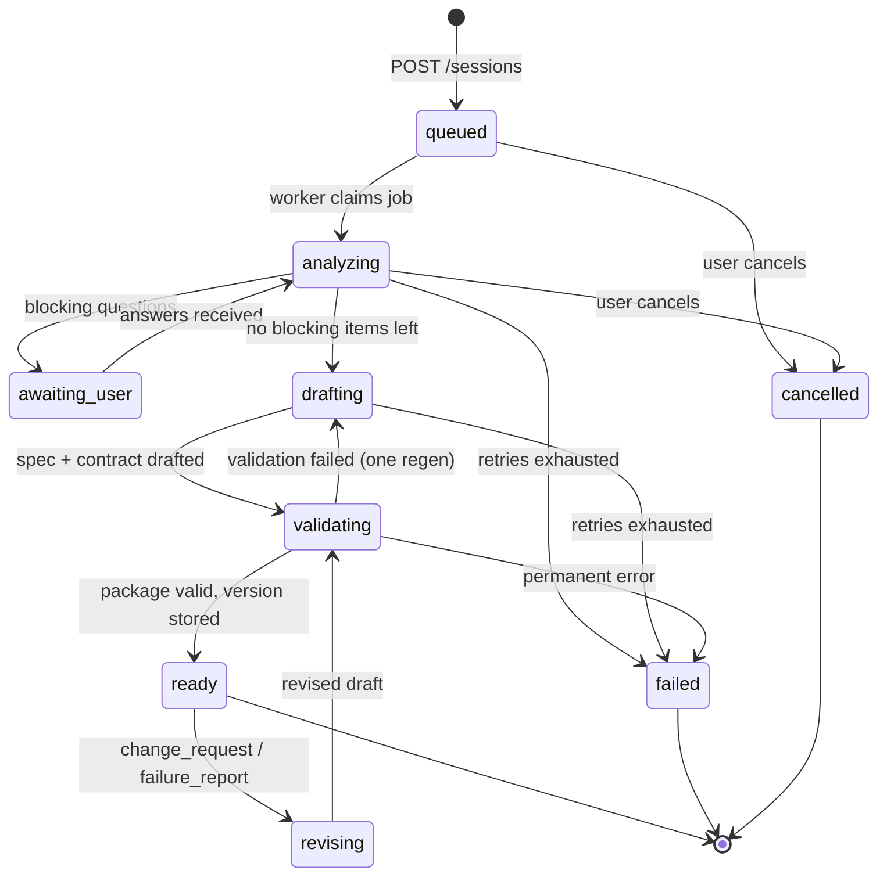

# PRD: Query Optimizer Service (Standalone Spec Agent)

| | |
|---|---|
| **Status** | Draft v1.0 |
| **Date** | 2026-11-09 |
| **Type** | Portfolio-grade AI + backend system |
| **Derived from** | Query Optimizer in the Multi-Agent App Builder PRD |
| **Estimated effort** | ~65 hours (7-8 weeks at 8-10 h/week) |

---

## 1. Overview

### 1.1 Problem
AI coding agents fail mostly because requirements are vague and components disagree, not because the code is bad. Users either get interrupted by endless questions or the agent silently guesses wrong. There is no standard, measurable layer that turns a rough idea into a build-ready, versioned specification.

### 1.2 Product vision
A service (HTTP API plus MCP server) that accepts a rough software idea and returns a **build-ready package**: master spec, explicit assumptions, only the blocking questions that matter, per-component sub-specs, and a versioned API contract (OpenAPI 3.1). It is stateful: answers and change requests produce a new version plus a diff. Any coding agent or builder can sit behind it.

### 1.3 Goals
| ID | Goal |
|---|---|
| G1 | Produce strictly validated, machine-readable spec packages (schema + OpenAPI lint + consistency checks) |
| G2 | Ask questions only for irreversible decisions; default and record everything else as assumptions |
| G3 | Versioned specs and contracts with diffs across revisions |
| G4 | Expose as REST API and MCP server so Claude Code, Cursor, or any agent can call it |
| G5 | Quantitative proof of value: same builder, raw prompt vs optimizer output, compare pass rates |
| G6 | Durable, observable, testable backend (idempotency, retries, streaming, FakeGateway in CI) |

### 1.4 Non-goals (v1)
- Generating application code
- Multi-tenant auth, billing, user accounts (single bearer token)
- Fine-tuning any model
- A visual spec editor
- Specs for mobile/desktop targets (web apps only)

### 1.5 Success metrics
| Metric | Target |
|---|---|
| Spec validity (schema + OpenAPI lint pass) | >= 95% of 30 benchmark prompts, after at most one repair |
| Question precision (asked question was truly blocking) | >= 80% on labelled set |
| Question recall (blocking ambiguity detected) | >= 80% on labelled set |
| Downstream lift | Builder pass rate with optimizer output beats raw prompt by a measured margin (report the real number, even if small) |
| Duplicate-request prevention | 0 duplicate sessions per repeated `Idempotency-Key` |
| SSE replay | 0 gaps / 0 duplicates after reconnect |
| p95 latency, non-LLM endpoints | < 200 ms |
| Median time to first spec version | <= 45 s |
| Test coverage on `pipeline/`, `schemas/`, `storage/` | >= 80% |

---

## 2. Users and Use Cases

### 2.1 Personas
- **Agent developer:** wires the service into a coding agent via MCP or REST before the build step.
- **End user / PM:** pastes an idea, answers a few questions, receives a spec and contract.
- **Operator (you / reviewer):** checks metrics, reruns evals, inspects spec diffs.

### 2.2 User stories
| ID | As a... | I want... | So that... |
|---|---|---|---|
| US1 | End user | to submit text, URL, or PDF as my idea | I can describe it however is easiest |
| US2 | End user | to be asked questions only when a wrong guess is costly to undo | I am not interrupted needlessly |
| US3 | End user | to see every assumption the system made | I can correct a wrong one cheaply |
| US4 | Agent developer | to call the service as an MCP tool | my coding agent gets a spec before building |
| US5 | Agent developer | an OpenAPI 3.1 contract that passes lint | frontend and backend agents agree on endpoints |
| US6 | End user | to send a change request and get a new version with a diff | I see exactly what changed |
| US7 | Agent developer | to send a failure report and get a revised spec | build errors caused by the spec get fixed at the source |
| US8 | Operator | retried requests never create duplicates | flaky networks are harmless |
| US9 | Operator | one command to rerun the evaluation | results are reproducible |
| US10 | Operator | per-stage latency, token, and cost metrics | I see where time and money go |

---

## 3. Functional Requirements

### 3.1 Intake
| ID | Requirement | Priority |
|---|---|---|
| FR-1 | `POST /sessions` accepts text plus optional attachments (URL, PDF) | P0 (text), P1 (rest) |
| FR-2 | `Idempotency-Key` header required; reuse returns the existing session | P0 |
| FR-3 | Intake normalizer converts inputs to a unified `request` object. External content is wrapped as quoted data, never as instructions | P1 |

### 3.2 Analysis and questioning
| ID | Requirement | Priority |
|---|---|---|
| FR-4 | **Ambiguity Analyzer** extracts goals, entities, features, constraints, and a list of ambiguities | P0 |
| FR-5 | **Irreversibility Classifier** labels each ambiguity: `blocking` (costly to undo, e.g. auth model, data ownership, payments, target platform) or `defaultable` | P0 |
| FR-6 | Only `blocking` items become questions, capped (default 3 per round). Each defaultable item becomes an assumption with a rationale | P0 |
| FR-7 | Session moves to `awaiting_user` until questions are answered via `POST /sessions/{id}/answers` | P0 |

### 3.3 Spec production
| ID | Requirement | Priority |
|---|---|---|
| FR-8 | **Master Spec** generated: summary, user flows, features with acceptance criteria, non-functional notes, assumptions | P0 |
| FR-9 | **Decomposer** produces sub-specs per component (frontend, backend, database, supporting), each listing pages/entities/endpoints and a contract reference | P0 |
| FR-10 | **Contract Generator** outputs OpenAPI 3.1 plus an entity schema, versioned `contract.vN` | P0 |
| FR-11 | All LLM outputs are strict JSON validated by Pydantic; one repair retry with the validation error appended, a second failure is a permanent error | P0 |

### 3.4 Validation
| ID | Requirement | Priority |
|---|---|---|
| FR-12 | **Consistency Checker** (deterministic code, not LLM): every frontend page references existing endpoints, every endpoint references existing entities, every acceptance criterion maps to a feature | P0 |
| FR-13 | OpenAPI document passes a linter (e.g. Spectral or openapi-spec-validator) | P0 |
| FR-14 | Failed checks trigger one automatic regeneration of the offending section, then surface as a warning in the package | P1 |

### 3.5 Versioning and revision
| ID | Requirement | Priority |
|---|---|---|
| FR-15 | Every package is immutable and numbered (`spec.v1`, `v2`...). Revisions never overwrite | P0 |
| FR-16 | `POST /sessions/{id}/revisions` accepts `change_request` (user) or `failure_report` (builder). The Revision stage decides what to regenerate | P0 |
| FR-17 | `GET /sessions/{id}/diff?from=1&to=2` returns a structured, human-readable diff of spec, assumptions, and contract | P0 |
| FR-18 | Breaking contract changes (removed endpoint, changed field type) are flagged explicitly | P1 |

### 3.6 Interfaces
| ID | Requirement | Priority |
|---|---|---|
| FR-19 | REST API (section 5.6) | P0 |
| FR-20 | MCP server exposing tools: `create_spec`, `answer_questions`, `revise_spec`, `get_contract`, `diff_versions` | P0 |
| FR-21 | `GET /sessions/{id}/events` SSE stream with monotonic `seq` ids and `Last-Event-ID` replay | P1 |
| FR-22 | Export: package as JSON, Markdown spec, and `openapi.yaml` | P0 |

### 3.7 Model gateway
| ID | Requirement | Priority |
|---|---|---|
| FR-23 | All LLM calls go through one gateway (LiteLLM), no provider SDK elsewhere | P0 |
| FR-24 | `config/models.yaml` maps stage -> model, temperature, max tokens, fallbacks; versions pinned | P0 |
| FR-25 | Gateway records tokens, latency, cost per call into the `stages` row and metrics | P0 |
| FR-26 | Daily spend cap; new sessions rejected with a clear error once exceeded | P0 |

### 3.8 Durability
| ID | Requirement | Priority |
|---|---|---|
| FR-27 | Postgres-backed job queue, `FOR UPDATE SKIP LOCKED`, 60 s leases renewed every 20 s | P1 |
| FR-28 | Transient failures retry with exponential backoff and jitter; permanent failures mark the session `failed` | P0 |
| FR-29 | Stages are idempotent via `(session_id, stage_key)` + `input_hash`; resume skips finished stages | P0 |

---

## 4. Non-Functional Requirements

| Category | Requirement |
|---|---|
| **Reliability** | At-least-once execution, exactly-once effects. A crash loses at most one in-flight LLM call |
| **Security** | Bearer token; API keys only from env, never logged; external content treated as data; input size limits; URL fetcher blocks private IP ranges (SSRF protection) |
| **Performance** | Non-LLM endpoints p95 < 200 ms; SSE latency < 1 s |
| **Observability** | JSON logs with `session_id`, `stage`, `model`, `trace_id`; Prometheus metrics with low-cardinality labels |
| **Reproducibility** | Pinned models and temperatures; eval inputs/outputs saved as JSON; `make eval` reruns everything |
| **Maintainability** | Prompts versioned in `prompts/<stage>/vN.md` |
| **Testability** | `FakeGateway` with canned outputs; CI makes no real LLM calls |
| **Portability** | `make up` starts the full stack with Docker |

---

## 5. System Design

### 5.1 Architecture



### 5.2 Session lifecycle



All transitions pass through one `transition(current, target)` function; any other path raises `InvalidTransition`. `ready` can re-enter via `revising`, so it is terminal only for a given version.

### 5.3 Components

| Component | Responsibility | Tech |
|---|---|---|
| API service | Sessions, answers, revisions, diff, export, SSE | FastAPI |
| MCP server | Exposes the five tools over MCP, calls the same service layer | Python MCP SDK |
| Postgres | Sessions, jobs, stages, versions, questions, events, idempotency keys | Postgres 16 |
| Worker pool | Claims jobs, renews leases, runs the pipeline | Python process, N replicas |
| Pipeline orchestrator | Advances state, persists after each stage, resumes | Explicit state machine |
| Ambiguity Analyzer | Extract goals, entities, features, ambiguities | Prompted LLM, JSON |
| Irreversibility Classifier | Label each ambiguity blocking or defaultable | Prompted LLM + rule table |
| Master Spec Writer / Decomposer / Contract Generator | Produce spec, sub-specs, OpenAPI | Prompted LLM, JSON |
| Validators | Schema, OpenAPI lint, consistency | Plain code (deterministic) |
| Diff Engine | Structured diff between versions, breaking-change detection | Plain code |
| Revision stage | Decide which sections to regenerate | Prompted LLM + dependency map |
| Model gateway | Unified LLM access, fallbacks, cost, spend cap | LiteLLM |
| Observability | Logs, metrics, dashboard | structlog, Prometheus, Grafana |

### 5.4 The irreversibility rule (core design decision)
A decision is `blocking` if getting it wrong would force rework across more than one component or lose user data. Initial rule table, refined by the labelled benchmark:

| Category | Example | Class |
|---|---|---|
| Auth model | None vs email/password vs OAuth | blocking |
| Data ownership / multi-user | Single user vs per-user data | blocking |
| Payments / money handling | Real payments vs mock | blocking |
| Target platform | Web vs mobile | blocking |
| Persistent data model core | Primary entities and relations | blocking if not inferable |
| Styling, copy, colors | Theme, button labels | defaultable |
| Pagination, sorting, validation messages | Page size 20 | defaultable |
| Library choices | Charting library | defaultable |

The classifier outputs the category, a reason, and a confidence; low-confidence items default to `blocking` only if the cap allows, otherwise become flagged assumptions.

### 5.5 Package schema (output)

```json
{
  "session_id": "ses_...",
  "version": 2,
  "master_spec": { "summary": "", "user_flows": [], "features": [{ "id": "F1", "title": "", "acceptance": [] }] },
  "assumptions": [{ "id": "A1", "text": "", "rationale": "", "category": "", "overridable": true }],
  "open_questions": [],
  "sub_specs": { "frontend": {}, "backend": {}, "database": {}, "supporting": {} },
  "contract": { "version": 2, "openapi": "3.1.0", "entities": [] },
  "validation": { "schema_ok": true, "openapi_lint_ok": true, "consistency_ok": true, "warnings": [] },
  "diff_from_previous": null
}
```

Message envelope (internal and MCP): `id` (`^msg_\d+$`), `from`, `to`, `type` in `{request, ambiguity_report, question_to_user, answer, spec, sub_spec, contract, change_request, failure_report}`, `schema_version`, `payload`. Unknown types and empty required fields are rejected.

### 5.6 API surface

| Method | Path | Purpose |
|---|---|---|
| POST | `/sessions` | Create session (requires `Idempotency-Key`) |
| GET | `/sessions/{id}` | Status, current version, cost summary |
| GET | `/sessions/{id}/events` | SSE stream with replay |
| POST | `/sessions/{id}/answers` | Answer blocking questions |
| POST | `/sessions/{id}/revisions` | Submit change_request or failure_report |
| GET | `/sessions/{id}/versions/{n}` | Fetch a package |
| GET | `/sessions/{id}/diff` | Diff between two versions |
| GET | `/sessions/{id}/export` | JSON, Markdown, or openapi.yaml |
| POST | `/sessions/{id}/cancel` | Cancel |
| GET | `/metrics` | Prometheus |
| GET | `/healthz` | Liveness + DB check |

MCP tools: `create_spec(idea)`, `answer_questions(session_id, answers)`, `revise_spec(session_id, feedback)`, `get_contract(session_id, version?)`, `diff_versions(session_id, from, to)`.

### 5.7 Data model

| Table | Key columns |
|---|---|
| `sessions` | id, status, trace_id, current_version, spend_usd, idempotency_key (unique), created_at |
| `jobs` | id, session_id, status, attempts, max_attempts, run_after, leased_until, locked_by |
| `stages` | id, session_id, stage_key, status, input_hash, output (jsonb), model, tokens_in, tokens_out, cost_usd, latency_ms; unique `(session_id, stage_key)` |
| `versions` | session_id, version, package (jsonb), created_from (initial/change/failure), unique `(session_id, version)` |
| `questions` | id, session_id, round, text, category, answer, answered_at |
| `events` | session_id, seq (monotonic per session), type, payload, created_at |
| `daily_spend` | day (PK), usd |

### 5.8 Retry and idempotency rules
- `run_after = now() + min(300, 2^attempts) s + random(0,1) s`; `max_attempts` default 5.
- Transient: HTTP 429, timeouts, 5xx. Permanent: schema failure after repair, invalid transition, unanswered questions past TTL.
- A stage is skipped on resume only if `status='done'` and `input_hash` matches. Hash covers stage key, upstream output hashes, prompt version, model id, config version.
- Versions are inserted with `ON CONFLICT DO NOTHING` so a replayed job cannot create a duplicate version.

### 5.9 Security
- Quoted-data wrapping and system-prompt hardening for URL/PDF content; no tool or network access for any LLM stage.
- URL fetcher: scheme allow-list, private/loopback IP block, size and time limits, redirect cap.
- Bearer token, per-IP rate limit, request size limits, per-session max cost.
- Secrets from env only; never in logs or stored packages.

### 5.10 Observability

| Metric | Type | Labels |
|---|---|---|
| `stage_latency_seconds` | histogram | stage, model |
| `llm_tokens_total` | counter | stage, model, direction |
| `llm_cost_usd_total` | counter | stage, model |
| `session_status_total` | counter | status |
| `questions_asked_total` | counter | category |
| `validation_failures_total` | counter | check |
| `job_retries_total` | counter | reason |

Grafana: success rate, p50/p95 per stage, cost per session, validation failure breakdown, questions asked per session.

### 5.11 Model configuration

```yaml
version: 1
defaults: { temperature: 0.2, max_tokens: 6000, timeout_s: 90 }
configurations:
  single_model:
    analyzer: { model: provider-a/model-x }
    classifier: { model: provider-a/model-x }
    spec_writer: { model: provider-a/model-x }
    decomposer: { model: provider-a/model-x }
    contract_generator: { model: provider-a/model-x }
    revision: { model: provider-a/model-x }
  mixed_v1:
    analyzer: { model: provider-b/cheap-model }
    classifier: { model: provider-b/cheap-model }
    contract_generator: { model: provider-a/model-x }
fallbacks: { provider-b/cheap-model: [provider-a/model-x] }
spend_cap_usd_per_day: 10
```
Placeholders; pin real model versions at implementation time.

---

## 6. Evaluation Plan (the part that makes this stand out)

Three experiments, all reproducible with `make eval`.

| Experiment | Method | Reported metric |
|---|---|---|
| **E1: Spec quality** | 30 prompts of varied vagueness; automated validators | Validity rate, repair rate, consistency failures |
| **E2: Question quality** | 30 prompts hand-labelled with the truly blocking ambiguities | Precision, recall, avg questions per session |
| **E3: Downstream lift** | Fixed simple builder (a single prompted coding agent) given raw prompt vs optimizer package, on 15 prompts x 3 reps; automated build/test checks | Pass rate difference, cost difference |

Integrity rule: report only measured numbers; if lift is zero or negative, report that and analyse why. Results saved to `evals/results/*.json`; `evals/REPORT.md` generated.

---

## 7. Testing Strategy

| Layer | What is tested |
|---|---|
| Unit | State transitions, input hashing, backoff math, consistency checker, diff engine, breaking-change detection |
| Contract | Pydantic schema tests per message type; bad id, unknown type, empty field rejected |
| Database | Queue concurrency (4 workers x 50 jobs once each), lease reclaim, idempotent insert, event `seq` allocation, duplicate version insert |
| Integration | Full pipeline with `FakeGateway`; question round trip; revision producing v2 and a diff; SSE replay; crash/resume |
| Eval | Real models, budget-guarded |

CI (GitHub Actions): ruff, type-check, pytest with Postgres service, coverage gate, image build. No real LLM calls.

---

## 8. Deployment
- Docker Compose: `api`, `worker` (2 replicas), `mcp`, `postgres`, `prometheus`, `grafana`.
- Healthchecks, restart policies, migrations on startup.
- Demo on a small VPS behind Caddy (TLS), bearer token, daily spend cap, rate limit.
- Deliverables: public demo URL, 2-minute video (including an MCP call from Claude Code), README with eval results.

---

## 9. Repository Structure

```
query-optimizer/
├── docker-compose.yml
├── Makefile                  # up, test, lint, migrate, eval
├── docs/                     # PRD.md, requirements.md, architecture.mmd
├── server/
│   ├── app/
│   │   ├── main.py           # FastAPI, REST, SSE
│   │   ├── mcp_server.py     # MCP tools
│   │   ├── worker.py         # claim loop, leases
│   │   ├── pipeline/         # states.py, orchestrator.py, resume.py
│   │   ├── stages/           # analyzer, classifier, spec_writer, decomposer, contract, revision
│   │   ├── validators/       # schema, openapi_lint, consistency
│   │   ├── diffing/          # version diff, breaking changes
│   │   ├── schemas/          # envelope + payload models
│   │   ├── storage/          # repositories, migrations
│   │   ├── gateway/          # LiteLLM wrapper, FakeGateway, cost, spend cap
│   │   └── observability/
│   └── tests/
├── prompts/                  # <stage>/vN.md
├── config/models.yaml
├── observability/            # prometheus.yml, Grafana JSON
├── evals/                    # prompts/, labels/, builder/, results/, REPORT.md
└── .github/workflows/ci.yml
```

---

## 10. Phases and Milestones (~65 h)

| Phase | Hours | Milestones | Exit check |
|---|---|---|---|
| 1. Foundation | 6 | Repo scaffold, Compose + Postgres, gateway v0 + FakeGateway, models.yaml | `make up` works; fake + one real call pass |
| 2. Schemas and validators | 8 | Envelope + package schemas, repair-retry helper, OpenAPI lint, consistency checker | Validator test suite passes |
| 3. Core pipeline | 14 | Analyzer, classifier, question gate, spec writer, decomposer, contract generator, prompts v1 | Canned-output tests; real-model smoke on 5 prompts |
| 4. Durability | 10 | Migrations, repos, job queue with SKIP LOCKED + leases, state machine, stage resume, idempotent API | Crash test: stages 1..k not re-run; duplicate POST yields one session |
| 5. Versioning and revision | 7 | Immutable versions, revision stage, diff engine, breaking-change flags | Change request yields v2 + correct diff |
| 6. Interfaces | 6 | SSE with replay, MCP server, export formats | Reconnect test no gaps; Claude Code calls `create_spec` |
| 7. Observability and CI | 6 | JSON logs with trace_id, metrics, Grafana, CI with coverage gate | Green CI; panels populate |
| 8. Evaluation | 10 | Prompt sets, labels, builder harness, runner with `--max-usd`, report | E1-E3 numbers measured |
| 9. Deploy and docs | 6 | Caddy, token, spend cap, README, demo video | Public link works end to end |

Total is about 73 h if everything is polished; ~65 h if Phase 7 dashboards and Phase 9 video are kept minimal. Plan for **8-9 weeks at 8-10 h/week**. Each phase is demo-able; do not start one before the previous exit check passes.

**Cut order if short on time:** (1) PDF/URL intake, (2) Grafana polish, (3) breadth of E3, (4) SSE. **Never cut:** Phases 2-5 and the E2/E3 evaluation, which are the core story.

---

## 11. Risks

| Risk | Likelihood | Impact | Mitigation |
|---|---|---|---|
| Over/under-questioning | High | High | Rule table, labelled set, precision/recall tracked |
| Spec drift across revisions | Med | Med | Immutable versions, diffs, breaking-change flags |
| Bad master spec poisons downstream | Med | High | Strict schema, deterministic consistency checks, one regen |
| Over-specification | Med | Med | Spec states requirements, not implementation; "assumption" label on guesses |
| Zero measured downstream lift | Med | Med | Report honestly; analyse failure categories |
| LLM JSON drift | High | Med | Pydantic, repair retry, pinned versions |
| Model bill | Med | Med | `--max-usd`, daily cap, FakeGateway |
| Prompt injection via URL/PDF | Med | High | Quoted data, no tools for LLM stages, SSRF protection |

---

## 12. Open Questions

| # | Question | Needed by | Default |
|---|---|---|---|
| 1 | Which builder for experiment E3 | Phase 8 | A single-prompt coding agent via the gateway |
| 2 | Contract format: OpenAPI only, or also JSON Schema for entities | Phase 2 | OpenAPI 3.1 with component schemas |
| 3 | Providers for the first two configurations | Phase 1 | One cheap, one strong, via OpenRouter |
| 4 | SSE tailing: LISTEN/NOTIFY vs polling | Phase 6 | Poll every 500 ms |
| 5 | Question TTL before session fails | Phase 4 | 24 h |

---

## 13. Definition of Done
- [ ] All P0 requirements implemented; P1 done or explicitly deferred in README
- [ ] Every mandatory test passes in CI; coverage gate met
- [ ] Crash/resume demonstrated in a test and in the video
- [ ] `evals/REPORT.md` has measured E1, E2, E3 results
- [ ] MCP tool call from a real coding agent demonstrated
- [ ] Public demo live, token-protected, spend-capped
- [ ] README states known limits honestly (single tenant, single region)
