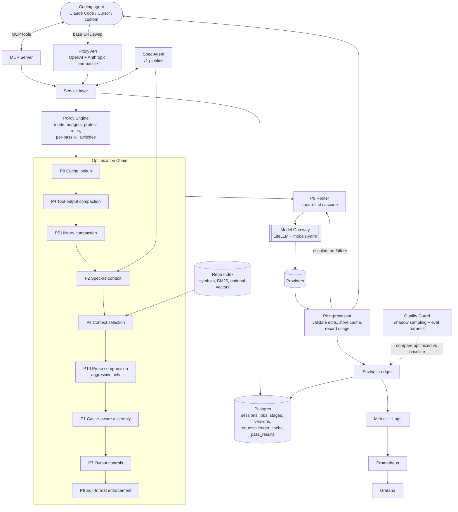

# PRD v2: Token-Optimizing Layer for Coding Models

| | |
|---|---|
| **Status** | Draft v2.0 (extends `PRD.md` v1.0) |
| **Date** | 2026-11-11 |
| **Type** | Portfolio-grade AI + backend system |
| **Estimated effort** | ~100 h total (v1 core ~65 h + ~35 h for the layer) |

> **What changed:** v1 was a spec agent that sits in front of a builder. v2 keeps all of it and adds a **drop-in optimization layer between any coding agent and any LLM**. It rewrites every request to use fewer tokens while holding output quality constant, and it measures the savings. Everything in v1 not mentioned here (durability, SSE, MCP spec tools, versioning, gateway, observability, testing, deployment) is unchanged.

---

## 1. Positioning

**One-line pitch:** *A proxy and MCP layer that makes any coding agent cheaper: it sends the model less, asks for less back, routes to the cheapest model that can do the job, and proves the quality did not drop.*

The spec agent is now the **first and highest-leverage optimization pass**, because a compact, structured spec replaces long, repeated, ambiguous prompt history and reduces rework loops. The rest of the layer attacks the other places tokens go.

## 2. Where tokens actually go in a coding-agent session

| Source | Why it is expensive | Pass that attacks it |
|---|---|---|
| Context resent every turn | Agent loops resend the system prompt, file contents, and history on each call, so input tokens dominate | P1 cache-aware assembly, P3 context selection, P5 history compaction |
| Whole-file reads | The agent reads 500 lines to change 5 | P3 slices and repo map |
| Tool/log output | Build logs, test output, stack traces | P4 tool-output compaction |
| Whole-file rewrites | Output tokens cost more than input tokens | P6 edit-format enforcement |
| Verbose replies | Preambles, restated plans | P7 output controls |
| Rework loops | Vague spec leads to wrong build leads to fix cycles | P2 spec-as-context (v1 optimizer) |
| Over-powered model | Strong model used for trivial steps | P8 routing and cascade |
| Repeated identical calls | Retries, duplicate agent steps | P9 response cache |

Truth source for all accounting is the **provider-reported usage** on each response. Local tokenizers are estimates only, used for budgeting before a call.

## 3. Goals and metrics

| ID | Goal |
|---|---|
| G7 | Reduce total tokens and cost per completed task versus an unoptimized baseline |
| G8 | Hold quality: task pass rate within an agreed tolerance of baseline |
| G9 | Be drop-in: work by changing a base URL (proxy) or adding an MCP server |
| G10 | Fail open: if the layer errors, the original request goes through untouched |
| G11 | Show a per-pass savings breakdown (ablation) so every claim is attributable |

| Metric | Target (hypothesis, to be measured and reported honestly) |
|---|---|
| Input tokens per completed task | Reduced versus baseline in `balanced` mode; report the real percentage |
| Cost per completed task | Reduced versus baseline; report the real percentage |
| Pass rate | Within -2 percentage points of baseline in `safe` and `balanced`; `aggressive` may trade more, reported as a Pareto point |
| Added proxy latency (non-LLM) | p95 < 150 ms for passes P1, P4, P5, P7, P9 |
| Fail-open correctness | 100% of injected pass failures yield a passthrough, never an error to the client |
| Cache correctness | 0 stale-cache serves in the invalidation test suite |

No savings number is promised in advance. Reduction depends on the agent, repo size, and task mix; the evaluation reports measured results, including cases where a pass does nothing or hurts.

## 4. Integration modes

| Mode | How | Use |
|---|---|---|
| **Proxy** | OpenAI-compatible `/v1/chat/completions` and Anthropic-compatible `/v1/messages`; the client only swaps its base URL | Claude Code, Cursor, Aider, any custom agent |
| **MCP** | Tools: `create_spec`, `answer_questions`, `revise_spec`, `get_contract`, `diff_versions`, plus `get_context(task)` and `savings_report()` | Agents that call tools |
| **Library** | `optimizer.optimize(request) -> (request', report)` | Embedding in your own agent |
| **Dry run** | `POST /v1/optimize` returns the rewritten payload and a per-pass report without calling any model | Debugging and demos |

Optimization modes: `off` (passthrough + metrics only), `safe` (lossless passes only), `balanced` (default), `aggressive` (adds lossy prose compression and aggressive routing).

## 5. Optimization passes (ordered chain)

Each pass is a pure function `request -> (request', PassReport)` with its own kill switch, mode gating, and unit tests. Passes never modify content marked **protected**: the user's latest instruction, error messages being debugged, code the agent is about to edit, and anything the client tags `x-optimizer-protect`.

| Pass | What it does | Lossless? | Modes |
|---|---|---|---|
| **P1 Cache-aware assembly** | Reorders the prompt so the stable prefix (system prompt, spec, contract, repo map) comes first and volatile content last; inserts provider cache breakpoints (e.g. Anthropic `cache_control`); keeps the prefix byte-stable across calls so provider prompt caching actually hits | Yes | safe+ |
| **P2 Spec-as-context** | Replaces raw idea text and long chat history with the compact spec package; sends only the sub-spec relevant to the current agent role (v1 optimizer) | Mostly | balanced+ |
| **P3 Context selection** | Builds a repo map (symbols and signatures via tree-sitter); retrieves relevant files with BM25 (optional embeddings); sends file slices or signatures instead of whole files; the model can request more through a tool | No (selection) | balanced+ |
| **P4 Tool-output compaction** | Strips ANSI, dedupes repeated lines, keeps head and tail plus all error lines, collapses stack-trace frames outside the project, summarizes passing tests | Mostly | safe+ |
| **P5 History compaction** | Rolling summary of old turns; drops superseded file reads and duplicate tool results; keeps decisions, constraints, open errors | No (summary) | balanced+ |
| **P6 Edit-format enforcement** | Instructs and validates search-replace or unified-diff output; rejects whole-file rewrites above a size threshold with one retry; reduces expensive output tokens | Yes | balanced+ |
| **P7 Output controls** | Sets `max_tokens` per stage, stop sequences, a "no preamble, no restating the plan" style line, structured output where possible | Yes | safe+ |
| **P8 Routing and cascade** | Classifies step difficulty (rule table first, small model second); tries the cheap model first; escalates to the strong model when a validator fails (build, tests, schema); respects a per-session budget | No (policy) | balanced+ |
| **P9 Response cache** | Exact-match cache keyed on a normalized request hash plus model and prompt version; semantic cache is off by default for code generation | Yes (exact) | safe+ |
| **P10 Prose compression** | LLMLingua-style token pruning on natural-language context only, never on code | No | aggressive only |
| **P11 Budget governor** | Per-session token and cost budgets; on approach, degrades (smaller context, cheaper model) before refusing | n/a | all |

**Design rules**
- Savings from P1 are about cost, not token count: cached tokens still count as input but are billed at a discount. Report both **raw tokens** and **billed cost** and never mix them.
- Lossy passes (P2, P3, P5, P8, P10) must be justified by the evaluation. If ablation shows a pass saves little or hurts pass rate, it ships disabled.
- Pass order matters: P4 and P5 shrink content, P3 selects it, P1 then arranges it for caching, P7 and P6 shape the output request, P9 and P8 act at the call boundary.

## 6. Architecture

### 6.1 Request lifecycle

1. Client sends a chat or messages request to the proxy with a bearer token and optional `x-optimizer-mode`, `x-session-id`, `x-optimizer-protect` headers.
2. Policy Engine resolves mode, budget remaining, and enabled passes.
3. P9 checks the cache; a hit returns immediately and is logged as a saving.
4. The chain rewrites the request, each pass emitting a `PassReport` (tokens before, tokens after estimated, bytes changed, latency, skipped reason).
5. Router picks the model; Gateway calls the provider.
6. Post-processor validates the response (edit format, schema), stores it in cache, and records **provider-reported usage**. A validation failure triggers one retry, then escalation to a stronger model.
7. Savings Ledger stores the request, per-pass reports, actual usage, and a counterfactual estimate of baseline usage (estimated from the original payload; labelled as estimate).
8. Any exception in steps 2-4 or 6 results in **fail-open**: the original request is forwarded unchanged and the failure is counted in `optimizer_passthrough_total`.

### 6.2 Quality Guard
- **Shadow sampling (opt-in):** for a small percentage of requests, also send the unoptimized request to the same model and compare outputs with a cheap automated check (diff applies cleanly, tests pass). Used only in evaluation and staging; costs extra tokens by design.
- **Per-pass circuit breaker:** if a pass's downstream validator failure rate rises above a threshold over a window, it auto-disables for that session and emits an alert.
- **Protected content rules:** never compress user instructions, active error text, or files under edit.

## 7. Additional functional requirements

| ID | Requirement | Priority |
|---|---|---|
| FR-30 | OpenAI-compatible and Anthropic-compatible proxy endpoints, streaming supported | P0 |
| FR-31 | `POST /v1/optimize` dry-run returns the rewritten payload and per-pass report | P0 |
| FR-32 | Optimization chain with per-pass interface, mode gating, kill switches, protected content | P0 |
| FR-33 | Fail-open on any optimizer error | P0 |
| FR-34 | P1 cache-aware assembly with provider cache breakpoints and a prefix-stability test | P0 |
| FR-35 | P4 tool-output compaction | P0 |
| FR-36 | P7 output controls | P0 |
| FR-37 | P9 exact-match response cache with invalidation on model, prompt version, or spec version change | P0 |
| FR-38 | P3 repo map and retrieval (BM25 first, embeddings optional) | P1 |
| FR-39 | P5 history compaction | P1 |
| FR-40 | P6 edit-format enforcement | P1 |
| FR-41 | P8 routing and cascade with validator-driven escalation | P1 |
| FR-42 | P11 budget governor with degrade path | P1 |
| FR-43 | P10 prose compression (aggressive mode) | P2 |
| FR-44 | Savings Ledger and `GET /stats` with per-pass, per-model, per-session breakdown | P0 |
| FR-45 | MCP tools `get_context` and `savings_report` | P1 |
| FR-46 | Streaming responses pass through with first-token latency overhead < 150 ms | P1 |

## 8. Data model additions

| Table | Key columns |
|---|---|
| `llm_requests` | id, session_id, trace_id, mode, model_requested, model_used, tokens_in_actual, tokens_out_actual, cached_tokens, cost_usd, baseline_tokens_in_est, latency_ms, outcome (ok/passthrough/cache_hit/escalated) |
| `pass_results` | request_id, pass_name, tokens_before_est, tokens_after_est, latency_ms, skipped_reason, error |
| `response_cache` | key (hash), model, prompt_version, spec_version, response, created_at, hits |
| `repo_index` | session_id, path, sha256, symbols (jsonb), tsvector, updated_at |
| `session_budgets` | session_id, max_tokens, max_usd, spent_tokens, spent_usd |

## 9. Observability additions

| Metric | Type | Labels |
|---|---|---|
| `tokens_in_total` | counter | model, mode, kind (actual / baseline_est) |
| `tokens_saved_est_total` | counter | pass |
| `cached_tokens_total` | counter | model |
| `pass_latency_seconds` | histogram | pass |
| `cache_hits_total` | counter | cache (response / prefix) |
| `router_escalations_total` | counter | from_model, to_model |
| `optimizer_passthrough_total` | counter | reason |
| `pass_breaker_open_total` | counter | pass |

Grafana additions: tokens baseline-est vs actual, savings by pass, cache hit rate, escalation rate, cost per completed task.

## 10. Evaluation additions (E4-E6)

| Experiment | Method | Reported |
|---|---|---|
| **E4 Token benchmark** | Fixed builder agent, 15 tasks x 3 reps, modes `off` / `safe` / `balanced` / `aggressive` | Tokens in/out, cost, pass rate, iterations, latency per mode |
| **E5 Pass ablation** | Start from `balanced`, disable one pass at a time | Marginal tokens, cost, and pass-rate impact of each pass; ranks passes by value |
| **E6 Pareto frontier** | Plot cost vs pass rate across modes and routing thresholds | Chart showing the best trade-off points |

Rules: use provider-reported usage; the baseline is the same agent and model with mode `off`; report variance across reps; a pass with no measurable benefit is reported as such and shipped disabled. Budget guard `--max-usd` on every run.

## 11. Revised phases and hours

| Phase | Hours | Content |
|---|---|---|
| 1-9 (from PRD v1) | ~65 | Foundation, schemas, spec pipeline, durability, versioning, interfaces, observability/CI, v1 evals, deploy |
| **10. Proxy and chain skeleton** | 8 | OpenAI/Anthropic-compatible proxy, chain interface, policy engine, fail-open, dry-run, ledger |
| **11. Lossless passes** | 8 | P1, P4, P7, P9; prefix-stability and cache-invalidation tests |
| **12. Selective passes** | 10 | P3 repo map and BM25, P5, P6, P2 integration with v1 spec |
| **13. Routing and budgets** | 5 | P8 cascade, P11 governor, circuit breakers |
| **14. Token evaluation** | 8 | E4-E6 harness, ablations, Pareto chart, report |
| **15. Docs and demo** | 3 | README, demo of before/after savings with Claude Code |

**Total: ~107 h, about 11-12 weeks at 9 h/week.** Per-pass tests and the extra dashboards are included.

**Staged delivery (recommended):** ship v1 spec agent first (~65 h), then phases 10-11 (~16 h) for a first working proxy with the lossless passes and measured savings (**~81 h milestone**). Phases 12-14 add the selective passes and the full evaluation.

**Cut order if short on time:** P10, then embeddings in P3, then semantic cache (already out), then P8 breadth. **Never cut:** fail-open, the savings ledger, and the E4/E5 evaluation. Without measurement the layer is just a claim.

## 12. Risks

| Risk | Likelihood | Impact | Mitigation |
|---|---|---|---|
| Quality regression from lossy passes | High | High | Modes, protected content, breakers, E4/E5 gating, lossy passes default off if unproven |
| Stale or wrong cache hits | Med | High | Key includes model, prompt version, spec version, file hashes; invalidation tests; semantic cache off for code |
| Proxy latency overhead | Med | Med | Passes are pure and fast; measured p95 budget; skip expensive passes on small requests |
| Provider API drift (compat endpoints, cache semantics) | Med | Med | Compat layer behind LiteLLM; contract tests against recorded fixtures |
| Misleading savings numbers | Med | High | Provider usage as truth; baseline estimate labelled; separate raw tokens and billed cost |
| Retrieval misses the needed file | Med | High | Tool to request more context; escalation on validator failure; protected files under edit |
| Scope growth (11 passes) | High | High | Staged delivery; lossless passes first; each pass independently shippable |
| Streaming complexity | Med | Med | Passthrough streaming first; post-processing only on completed responses where needed |
| Client leakage of secrets in prompts | Med | High | Redaction filter on ledger storage; do not log raw prompts by default |

## 13. Definition of Done additions
- [ ] Proxy works with at least one real coding agent by changing only the base URL
- [ ] Fail-open proven by an injected-failure test
- [ ] Savings Ledger and dashboard show baseline-est vs actual per pass
- [ ] E4, E5, E6 measured and reported honestly, including passes that did not help
- [ ] README includes a before/after demo and states which passes are enabled by default and why

## 14. Resume impact (updated)

| Version | Rating |
|---|---|
| v2 with measured E4-E6 results | **9/10**: an AI cost-optimization product with real backend engineering and a proof of value |
| v2 without evaluation | 6.5/10: looks like a wrapper with unproven claims |

Resume line: *"Built an LLM optimization proxy and MCP layer (FastAPI, Postgres, LiteLLM) that cuts coding-agent token cost via prompt caching, context selection, edit-format enforcement, and model cascading; measured X% token and Y% cost reduction at Z-point pass-rate change across 15 tasks, with per-pass ablation."* Fill X, Y, Z only with your measured numbers.
