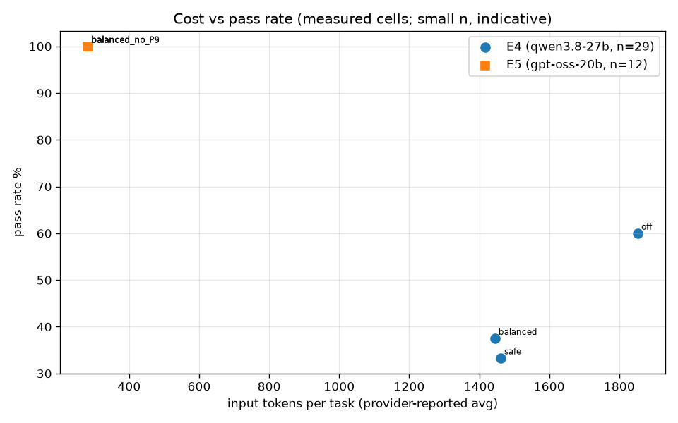

# Evaluation Report (auto-generated from measured result files)

_Generated from evals/results/*.json — only measured numbers appear here; anything missing is NOT MEASURED. Frozen labels: evals/prompts/labels.jsonl (user approval pending)._

## E1/E2 — spec quality + question quality (prompts v2)
- ran: 24/30 prompts · model: gpt-oss-120b pipeline (Groq free tier)
- E1 validity: 18/24 (0%); invalid: 0; quota-aborted: 6 (resume-safe)
- E2 precision: None · recall: None (micro, category-level)
- tokens_total_est: 247604

## E3 — downstream lift
**NOT MEASURED** (spec generation blocked on 120b quota; resumable).

## E4 token benchmark

- model: `groq/qwen/qwen3.8-27b` · cells: 48 (pass 14 / fail 15 / retryable-turn-cap 19)

- `balanced`: n=8 pass_rate=38% tokens_in_avg=1445 tokens_out_avg=186 iterations=2.375 latency=0.13s
- `off`: n=15 pass_rate=60% tokens_in_avg=1853 tokens_out_avg=228 iterations=2.933333333333333 latency=0.99s
- `safe`: n=6 pass_rate=33% tokens_in_avg=1461 tokens_out_avg=171 iterations=2.3333333333333335 latency=0.37s

## E5 pass ablation

- model: `groq/openai/gpt-oss-20b` · cells: 28 (pass 12 / fail 0 / retryable-turn-cap 16)

- `balanced`: n=4 pass_rate=100% tokens_in_avg=282 tokens_out_avg=816 iterations=1.0 latency=0.67s
- `balanced_no_P5`: n=4 pass_rate=100% tokens_in_avg=282 tokens_out_avg=816 iterations=1.0 latency=0.09s
- `balanced_no_P9`: n=4 pass_rate=100% tokens_in_avg=282 tokens_out_avg=816 iterations=1.0 latency=0.08s

## E6 — cost vs pass-rate Pareto
 · text table: results/pareto_table.txt

## Limitations
- Groq free tier: per-model 30 RPM / 1K RPD / 8K TPM / 200K TPD; several runs spanned multiple UTC days via the resumable quota-aware runners.
- Small n per config (see each table); single provider; tiny single-file tasks.
- Results are indicative, not statistically strong. No number on this page is estimated without the `_est` label; provider-reported usage is used everywhere else.